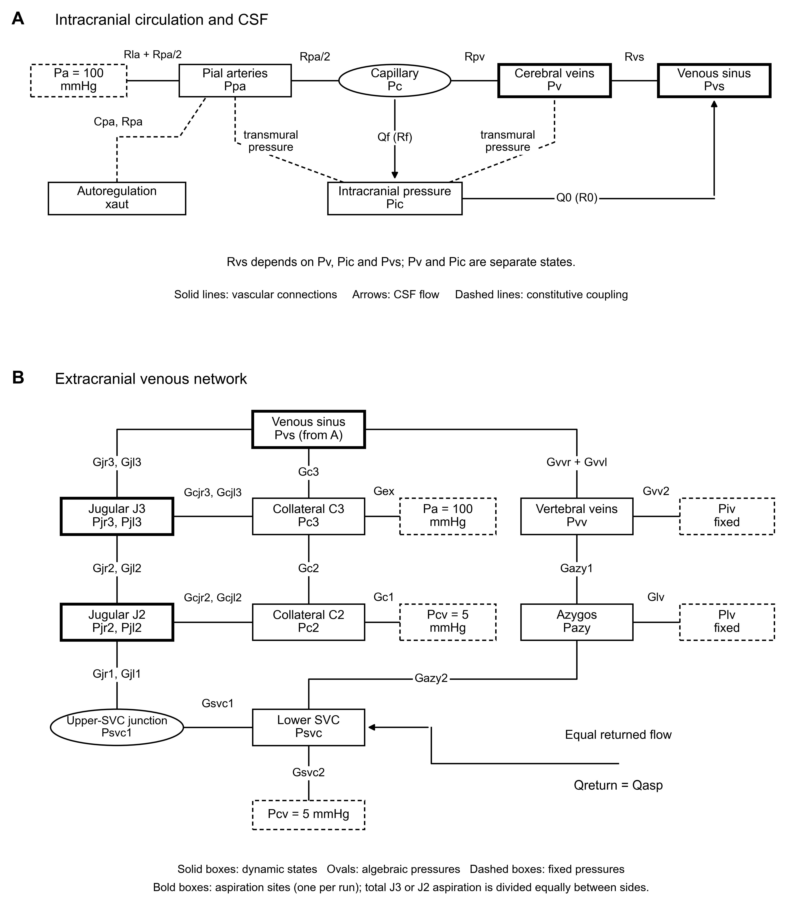

# Mathematical modeling of the effects of venous aspiration site and flow rate in post-traumatic intracranial hypertension

[](https://doi.org/10.5281/zenodo.24457183)
[](LICENSE)


Lumped-parameter model of intracranial hemodynamics, cerebrospinal fluid dynamics,
and extracranial venous drainage, used to compare how aspiration location and flow
rate affect intracranial pressure (ICP) in post-traumatic intracranial hypertension.
Aspiration is simulated from the cerebral veins, the venous sinus, and the
skull-base (J3) and mid-neck (J2) jugular segments.

The model combines the intracranial model of Ursino and Lodi with the extracranial
venous network of Gadda et al.



## Model

- 14 state variables: 13 intracranial and extracranial pressures and a cerebral
  autoregulation state
- Pressure-dependent terminal cerebral-vein resistance (Starling resistor) and
  jugular conductance
- Flow-controlled aspiration from the selected compartment, with equal return to
  the lower superior vena cava
- Fixed mean arterial (100 mmHg) and central venous (5 mmHg) pressures, supine
  posture

The baseline parameter set reproduces the supine hemodynamics reported by Gadda et
al. (2015).

## Installation

Requires Python 3.10–3.13.

```bash
git clone https://github.com/Adisu4/cerebral-hemodynamics-aspiration.git
cd cerebral-hemodynamics-aspiration
python -m venv .venv
source .venv/bin/activate        # Windows PowerShell: .venv\Scripts\Activate.ps1
python -m pip install -e ".[test,visualization]"
python -m pytest
```

## Reproducing the results

```bash
# Run all simulations (writes 89 simulation reports)
cerebral-hemodynamics-run --output-dir results/simulations

# Generate figures and tables from the saved results
cerebral-hemodynamics-plot --results-dir data/reports --output-dir figures --tables-dir tables
```

See [docs/reproduction.md](docs/reproduction.md) for details.

## Example

```python
from pathlib import Path
import numpy as np

from cerebral_hemodynamics_aspiration import integrate, make_tbi_parameters

parameters = make_tbi_parameters()
output_dir = Path("results/example")

baseline = integrate(
    parameters,
    parameters.initial_state(),
    label="tbi_baseline",
    output_dir=output_dir,
)

baseline_state = np.asarray(baseline["terminal_window_mean_state"], dtype=float)
intervention = integrate(
    parameters,
    baseline_state,
    label="pv_240",
    site="Pv",
    flow_ml_min=240.0,
    return_fraction=1.0,
    output_dir=output_dir,
)

delta_icp = (
    baseline["summary"]["icp_mean_mmhg"]
    - intervention["summary"]["icp_mean_mmhg"]
)
print(f"Predicted ICP reduction: {delta_icp:.2f} mmHg")
```

## Main result

ICP reduction from the post-traumatic baseline of 22.698 mmHg:

| Aspiration location | ΔICP at 240 mL/min (mmHg) | ΔICP at 480 mL/min (mmHg) |
|---|---:|---:|
| Cerebral veins | 3.033 | 6.133 |
| Venous sinus | 0.234 | 0.469 |
| Bilateral J3 (skull base) | 0.110 | 0.221 |
| Bilateral J2 (mid-neck) | 0.086 | 0.174 |

Results at all flow rates are in [`tables/supplementary/`](tables/supplementary).

## Repository contents

```text
src/cerebral_hemodynamics_aspiration/   model, parameters, simulation, figures
data/                                   saved simulation reports and trajectories
figures/                                manuscript and supplementary figures
tables/                                 manuscript and supplementary tables
tests/                                  regression and consistency tests
docs/                                   reproduction guide, model scope, provenance
```

## Citation

> Assefa AM, Kargarbahrkhazar B, Sattur MG, Srinivasan S, Jadidi M. Mathematical
> modeling of the effects of venous aspiration site and flow rate in post-traumatic
> intracranial hypertension: model code [software]. Zenodo; 2026.
> https://doi.org/10.5281/zenodo.24457183

## References

1. Gadda G, Taibi A, Sisini F, et al. A new hemodynamic model for the study of
   cerebral venous outflow. *Am J Physiol Heart Circ Physiol*. 2015;308:H217–H231.
   [doi:10.1152/ajpheart.00469.2014](https://doi.org/10.1152/ajpheart.00469.2014)
2. Ursino M, Lodi CA. A simple mathematical model of the interaction between
   intracranial pressure and cerebral hemodynamics. *J Appl Physiol*.
   1997;82:1256–1269.
   [doi:10.1152/jappl.1997.82.4.1256](https://doi.org/10.1152/jappl.1997.82.4.1256)
3. Ursino M, Lodi CA. Interaction among autoregulation, CO2 reactivity, and
   intracranial pressure: a mathematical model. *Am J Physiol*. 1998;274:H1715–H1728.
   [doi:10.1152/ajpheart.1998.274.5.H1715](https://doi.org/10.1152/ajpheart.1998.274.5.H1715)
4. Marmarou A, Shulman K, Rosende RM. A nonlinear analysis of the cerebrospinal
   fluid system and intracranial pressure dynamics. *J Neurosurg*. 1978;48:332–344.
   [doi:10.3171/jns.1978.48.3.0332](https://doi.org/10.3171/jns.1978.48.3.0332)

## Funding and acknowledgments

Supported in part by the National Institute of General Medical Sciences of the
National Institutes of Health under award number P20GM152301. Developed in the
Department of Biomechanics, University of Nebraska at Omaha, under the supervision
of Prof. Majid Jadidi, in collaboration with Dr. Mithun G. Sattur and Dr. Siddharth
Srinivasan, Department of Neurosurgery, University of Nebraska Medical Center.

## License

[MIT License](LICENSE). Not intended for clinical use.

## Contact

Adisu Mengesha Assefa, University of Nebraska at Omaha (aassefa@unomaha.edu)
